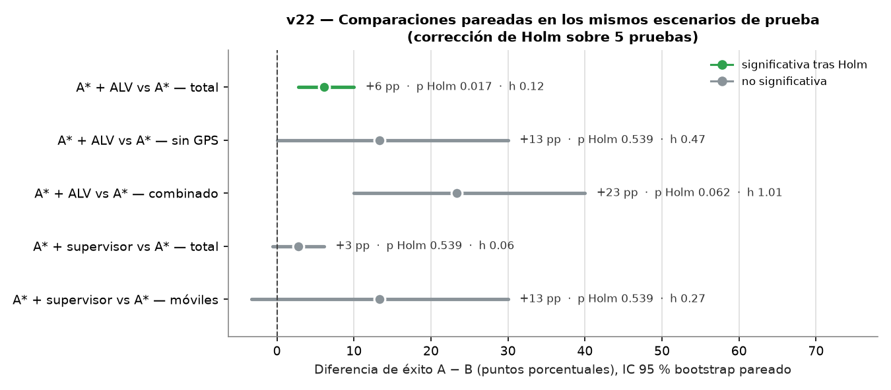

# NeuroFly-Bee Perú

**Navegación autónoma bioinspirada en abejas y moscas mediante redes neuronales profundas**
Proyecto final — MIA-203 Redes Neuronales y Aprendizaje Profundo (UNI FIIS), 2026-II.

Un dron virtual despega de una base, inspecciona puntos críticos de un río, evita
obstáculos (incluidos los imprevistos y los móviles) y regresa, combinando dos
módulos neuronales:

- **Mosca** — percepción y reacción local: CNN + GRU sobre un "ojo" egocéntrico.
- **Abeja** — memoria y retorno: red siamesa que compara la vista panorámica actual
  con la memorizada en la base para volver sin GPS.
- **Híbrido** — la abeja decide hacia dónde ir, la mosca cómo evitar obstáculos y un
  supervisor de seguridad valida cada orden.

Se compara contra líneas base clásicas (vuelo directo, campos de potencial, A*,
retorno visual ALV) en seis condiciones reproducibles.

> **Estado: v24** — artículo completo (11 págs.) con la defensa del simulador 2,5D, la ablación de la abeja y la significancia estadística; falta sólo la corrida completa en Colab para llenar los números en rojo. Preguntas de la defensa: [`docs/PREGUNTAS_DEFENSA.md`](docs/PREGUNTAS_DEFENSA.md).

## ▶ Ver la simulación

```bash
python scripts/build_viewer.py      # ≈ 10 s; con pesos entrenados agrega mosca, abeja e híbrido
```
y abra **`results/visor/index.html`** con doble clic (no necesita servidor ni internet).
Mapa animado con obstáculos móviles, 4 controladores lado a lado, ojo de la mosca, rayos,
panorama de la abeja, módulo que decide en cada paso, probabilidades de la red, vetos del
supervisor y lo que el dron *cree* cuando pierde el GPS.


### Simulación en vivo (v17)

```bash
python scripts/serve.py             # abre http://127.0.0.1:8000
```
Aparece la barra verde **● EN VIVO**: elija la condición (obstáculos móviles, viento, sin
GPS…), una semilla de **prueba** (20000–20999, o 🎲 al azar) y hasta 4 controladores, y
pulse **Simular**: en menos de un segundo se ven volando lado a lado. Sólo usa la
biblioteca estándar de Python (sin FastAPI). Las semillas de entrenamiento se rechazan,
así nadie puede «elegir» un escenario que la red ya vio.

| Ruta | Qué devuelve |
|---|---|
| `GET /api/catalogo` | condiciones, controladores disponibles y rango de semillas |
| `GET /api/simular?familia=dynamic&semilla=20042&controladores=astar,hybrid` | la simulación, en el formato del visor (400 si los parámetros son inválidos) |

**Video de respaldo** (por si falla la demo en vivo): `results/video/v16_demo.mp4` (≈ 30 s)
y `results/video/v16_demo.gif`. Se regenera con
```bash
pip install playwright imageio-ffmpeg && python -m playwright install chromium   # una vez
python scripts/record_video.py
```
> Plan completo en [`docs/PLAN_COMMITS.md`](docs/PLAN_COMMITS.md); cambios en
> [`CHANGELOG.md`](CHANGELOG.md).

## Estructura (§3.3 del enunciado)

```
neuroflybee/
├── README.md            descripción, resultados y cómo reproducir
├── requirements.txt     dependencias con versiones
├── pyproject.toml       paquete instalable (src layout)
├── data/                README con cómo se generan los datos (no se suben datos)
├── src/neuroflybee/     código del simulador, modelos, entrenamiento y evaluación
├── notebooks/           exploración y demo en Colab
├── configs/             hiperparámetros de cada experimento (YAML)
├── results/             tablas, figuras y logs del artículo
├── paper/               artículo IEEE (LaTeX + BibTeX)
├── docs/                plan de commits y mapeo contra la rúbrica
└── tests/               pruebas automáticas (pytest)
```

## Escenarios de evaluación (v3)


Regenerar: `python scripts/show_scenarios.py --seed 20000`

| Condición | Qué cambia |
|---|---|
| Nominal | Sólo obstáculos del mapa previo |
| Obstáculos no previstos | 4–8 obstáculos que no están en el mapa, cerca de la ruta |
| Obstáculos móviles | 2–4 obstáculos que cruzan la ruta de ida y vuelta |
| Viento | Deriva de 0.10–0.25 m por paso con ráfagas |
| Pérdida de GPS al regresar | Sin GPS tras visitar el último punto, con viento leve |
| Combinado | Todo lo anterior a la vez |

## Lo que percibe el dron (v4)


Regenerar: `python scripts/show_sensors.py --seed 20000`

| Sensor | Salida | Quién lo usa |
|---|---|---|
| Ojo de la mosca | Parche egocéntrico 32×32 (12 m × 12 m) con ruido de píxel | CNN+GRU de la mosca |
| Anillo de distancias | 32 rayos, alcance 8 m | Supervisor de seguridad, líneas base |
| Panorama de la abeja | Elevación del horizonte en 72 direcciones, alineado con brújula | Red siamesa de la abeja |
| GPS / brújula / odometría | Posición con ruido (puede perderse), rumbo, desplazamiento sin viento | Estimador de posición |

Los sensores son abstracciones (no hay cámara RGB): el ojo representa una cámara con
estimación de profundidad y el panorama, la silueta del horizonte que usan las abejas.

## Episodios completos (v5)


Regenerar: `python scripts/show_episode.py --seed 20000`

Un controlador de demostración (línea recta, sin evasión) muestra el bucle
observación → decisión → acción y los dos problemas que el proyecto debe resolver:
**choca** con obstáculos y, **sin GPS**, lo que el dron cree (línea roja) se separa
del recorrido real por la deriva del viento.

## Líneas base clásicas (v6)


Regenerar: `python scripts/show_baselines.py --episodes 10` (≈ 1 min en CPU; tabla en
`results/v6_preliminar.csv`).

| Línea base | Idea | Debilidad observada (preliminar, 10 escenarios) |
|---|---|---|
| Directo | Recta al objetivo | Choca casi siempre |
| Campos de potencial (Khatib, 1986) | Atracción al objetivo + repulsión de los rayos | Se atasca en mínimos locales |
| A* + replanificación (Hart et al., 1968) | Plan sobre el mapa previo + obstáculos detectados | Choca con obstáculos móviles (50 %) |
| A* + retorno ALV (Lambrinos et al., 2000) | Igual, y sin GPS vuelve con el vector promedio de hitos | Retorno errático sin GPS |

Sin GPS ninguna línea base clásica regresa de forma fiable a la base: ése es el hueco
que deben cubrir los módulos neuronales (mosca y abeja).

## Datos de entrenamiento (v7)


```bash
python scripts/generate_data.py      # ≈ 3 min en CPU → data/generated/*.npz (no se suben)
python scripts/show_dataset.py       # figuras + results/v7_experto.csv
```

| Conjunto | Partición | Episodios / escenarios | Muestras |
|---|---|---|---|
| Mosca (imitación) | entrenamiento | 400 | 76 077 |
| Mosca (imitación) | validación | 60 | 10 593 |
| Abeja (retorno) | entrenamiento | 600 | 38 400 |
| Abeja (retorno) | validación | 100 | 6 400 |

- **Maestro:** un experto privilegiado (A* con la posición real y el futuro de los
  obstáculos móviles) completa el 100 % de las misiones de validación en las 6 condiciones.
- **Estudiante:** la mosca sólo verá su ojo y el objetivo relativo estimado; por eso
  necesita memoria temporal (GRU) para anticipar los obstáculos móviles.
- Las acciones están desbalanceadas (40 % avanzar, 0.1 % mantener posición): se reportará F1 macro.

## Redes de la mosca (v8)


Regenerar: `python scripts/show_fly_models.py` (no requiere PyTorch; tabla en `results/v8_parametros.csv`).

| Modelo | Memoria temporal | Parámetros | Papel en el estudio |
|---|---|---|---|
| MLP | no (1 cuadro) | 306 118 | línea base neuronal sin convolución |
| CNN | no (1 cuadro) | 165 542 | ablación: CNN sin memoria |
| **CNN + GRU** | sí (4 cuadros) | **264 614** | **propuesta** |
| CNN + Transformer | sí (4 cuadros) | 431 526 | variante contemporánea |

Todas comparten la firma `forward(frames, goal) → logits`, por lo que el entrenamiento,
la evaluación y el controlador las usan sin distinguirlas. Hiperparámetros en
`configs/fly_models.yaml`. Las pruebas de PyTorch (`tests/test_fly_models.py`) se omiten
si PyTorch no está instalado y verifican formas, flujo de gradientes, uso de la secuencia
y que el conteo analítico de parámetros sea exacto.

## Entrenamiento de la mosca (v9)


```bash
python scripts/generate_data.py          # datos (una vez)
python scripts/train_fly.py              # 4 modelos × 3 semillas (requiere PyTorch; GPU recomendada)
python scripts/plot_fly_training.py      # curvas, matriz de confusión y tabla
```

O en Google Colab con un clic: [`notebooks/01_entrenar_colab.ipynb`](notebooks/01_entrenar_colab.ipynb).

| Elemento | Valor (`configs/train_fly.yaml`) |
|---|---|
| Pérdida | entropía cruzada con pesos ∝ frecuencia^-0.5 (máx. 10) |
| Optimizador | AdamW, lr 1e-3, weight decay 1e-4, coseno, recorte de gradiente 1.0 |
| Lote / épocas | 256 / hasta 15, parada temprana con paciencia 4 |
| Selección | mejor F1 macro en **validación** (la prueba no se usa para elegir nada) |
| Semillas | 0, 1, 2 → media ± d.e. |

Salidas: `checkpoints/<modelo>_s<semilla>.pt`, `results/v9_historial_*.json`,
`results/figures/v9_curvas_mosca.png`, `results/figures/v9_confusion_mosca.png`,
`results/v9_mosca_validacion.csv`.

## DAgger (v10)


```bash
python scripts/train_dagger.py     # requiere los checkpoints de la v9 (PyTorch)
python scripts/plot_dagger.py      # v10_dagger_mejora.png + results/v10_dagger.csv
```

Con imitación pura la red sólo conoce estados por los que pasó el experto; cuando se
equivoca, llega a estados nuevos (desplazamiento de distribución). DAgger la deja volar
(β = 0.5 → 0.25 → 0), el experto etiqueta los estados que ella visita, se agregan
120 escenarios nuevos de entrenamiento por iteración (semillas 400–759) y se reentrena.
Cada iteración se mide **en lazo cerrado** (éxito y choques) en escenarios de validación.

## Red de la abeja (v11)


```bash
python scripts/train_bee.py        # 3 semillas (PyTorch)
python scripts/show_bee_homing.py  # figura + results/v11_abeja_validacion.csv
```

Red siamesa 1D (172 547 parámetros): un mismo codificador con relleno **circular**
procesa la vista actual y la memorizada en la base; sus rasgos y su diferencia se fusionan
y una cabeza predice la dirección (cos, sin) y log(1 + distancia) a la base. Pérdida:
(1 − coseno) + 0.5 · Smooth-L1. Selección por error angular mediano en validación.

| Método (validación, 6 400 vistas) | Error angular mediano | Vistas con error ≤ 30° |
|---|---|---|
| ALV clásico (línea base) | 51.4° | 32 % |
| Red de la abeja | se completa al entrenar | se completa al entrenar |

## Controlador híbrido y supervisor (v12)


```bash
python scripts/show_controllers.py   # arquitectura, efecto del supervisor y, con pesos, los controladores neuronales
```

| Controlador | Navegador (abeja) | Control local | Supervisor |
|---|---|---|---|
| `fly` (Mosca) | ruta + estimación | red CNN+GRU | no |
| `bee` (Abeja) | ruta + **red de retorno visual** | A* | no |
| `hybrid` (Híbrido) | ruta + **red de retorno visual** | red CNN+GRU | **sí** |
| `hybrid_no_supervisor` | ídem | ídem | no (ablación) |

Los controladores neuronales se registran solos cuando hay pesos en `checkpoints/`
(última iteración de DAgger si existe). El **supervisor de seguridad** envuelve a
cualquier controlador (decorador) y, usando sólo los rayos, veta maniobras que acercarían
el dron a un obstáculo. Medido en 10 escenarios de prueba por condición: lleva los choques
del controlador directo de 100 % a 0 % con obstáculos fijos, pero no basta con obstáculos
móviles (A*: 50 % con y sin supervisor) ni con viento fuerte — ahí se necesita la
anticipación de la mosca.

## Benchmark y ablaciones (v14)


```bash
python scripts/run_benchmark.py        # ≈ 3 min sólo clásicos; con pesos agrega mosca, abeja e híbrido
```

Semillas de **prueba** 20000–20029 (30 por condición, 180 por controlador), nunca usadas
para entrenar ni para elegir hiperparámetros. Neuronales: cada semilla de entrenamiento
(0, 1, 2) es una repetición → media ± d.e.; todos: IC 95 % de Wilson.

| Controlador (clásicos, medido) | Éxito total | IC 95 % | Choques | Sin GPS | Combinado |
|---|---|---|---|---|---|
| Directo | 3 % | 2–7 % | 95 % | 0 % | 0 % |
| Campos de potencial | 48 % | 41–56 % | 3 % | 0 % | 0 % |
| A* | 56 % | 48–63 % | 16 % | 3 % | 0 % |
| A* + ALV | 62 % | 54–68 % | 16 % | 17 % | 23 % |
| A* + supervisor | 58 % | 51–65 % | 12 % | 3 % | 0 % |

Ninguna línea base clásica supera el 23 % sin GPS ni el 53 % con obstáculos móviles: ésa es
la meta para la mosca, la abeja y el híbrido (filas que se agregan al entrenar).
Ablaciones definidas en `configs/benchmark.yaml`: arquitectura de la mosca (MLP / CNN /
CNN+GRU / CNN+Transformer), imitación vs DAgger, retorno sin GPS (A* / A*+ALV / A*+red de
la abeja) y aporte de cada módulo (mosca / abeja+mosca / +supervisor). Tablas LaTeX en
`paper/tablas/`.

## Interpretabilidad y análisis de errores (v15)


```bash
python scripts/explain.py     # ≈ 3 min; con pesos agrega Grad-CAM (mosca) e Integrated Gradients (abeja)
```

- **Análisis de errores** (sin PyTorch, ya medido): cada fallo se clasifica por su causa en
  la simulación. En las líneas base clásicas domina la **deriva sin GPS** (21–28 % de todos
  los episodios) y los **choques con obstáculos móviles** (9–14 %); casi no hay choques con
  obstáculos fijos. Es la evidencia directa de qué deben resolver la abeja y la mosca.
- **Grad-CAM** sobre la última convolución de la mosca: qué zona del ojo (en cada uno de
  los 4 cuadros) provocó la maniobra.
- **Integrated Gradients** sobre la abeja, con la vista memorizada como referencia: qué
  direcciones del horizonte usó. Incluye prueba de **fidelidad por borrado** (borrar las
  direcciones más atribuidas debe cambiar la predicción más que borrar al azar) y verifica
  el axioma de completitud.

## Ablación de la abeja (v20)


```bash
python scripts/run_bee_ablation.py              # 3 semillas por variante (PyTorch)
python scripts/run_bee_ablation.py --sin-redes  # sólo el ALV, sin PyTorch
```

Cada variante cambia **una** decisión de la red de v11 (`configs/bee_ablation.yaml`), se
entrena con las mismas semillas, datos e hiperparámetros, y se evalúa en la partición de
**prueba** (`data/generated/bee_test.npz`, semillas 20000–20099, 6 400 vistas), que nunca se
usó para elegir épocas. El ALV clásico se mide sobre las mismas vistas.

| Variante | Qué cambia | Pregunta que responde | Parámetros |
|---|---|---|---|
| Siamesa (v11) | — (reutiliza `bee_s<semilla>.pt`) | referencia | 172 547 |
| Sólo vista actual | sin la vista memorizada en casa | ¿hace falta comparar con la base? | 160 259 |
| Siamesa sin resta | `[f_actual, f_base]` sin `f_actual − f_base` | ¿aporta la resta explícita? | 166 403 |
| Siamesa + lectura vectorial | cabeza plana (≈148 000 parámetros) → votos por sector sumados como vectores | ¿hacen falta tantos parámetros? | 24 725 |

La lectura vectorial (`models/bee.py`, `VectorReadoutHead`) conserva la geometría del
panorama: cada uno de los 18 sectores vota con un peso y la dirección es la suma vectorial
de los votos, la misma idea que el ALV pero con pesos aprendidos. La figura muestra también
el tamaño de las redes publicadas de Bee-Nav (868 y 10 820 parámetros) como escala.

## Validación del sensor 2,5D (v21)


```bash
python scripts/validate_sensor.py      # 30 escenarios de prueba, ~5 s, sin PyTorch
```

**¿Por qué 2,5D y no 3D?** El dron vuela a altura fija y el vector a casa es horizontal
(igual que en Firlefyn et al., 2024, que fijan el cuadricóptero a 1,89 m), así que el
movimiento se simula en el plano. La percepción, en cambio, no es plana: la abeja ve la
**silueta del horizonte**, la elevación angular de cada objeto según su altura y distancia,
con oclusiones (`sim/sensors.py`, `PanoramaSensor`). Antes de entrenar con ese sensor se
comprueba que reproduce tres propiedades de los panoramas reales:

| Propiedad (referencia) | Qué se mide | Resultado (30 escenarios de prueba) |
|---|---|---|
| IDF traslacional (Zeil et al., 2003) | la diferencia con la vista de casa crece con la distancia | ρ de Spearman medio 0,99; monótona en el 100 % |
| IDF rotacional | girar el panorama y buscar el mínimo recupera el rumbo | error mediano 0° a 1 y 2 m; 2,5° a 4 m |
| Área de captura del ALV | puntos donde el ALV apunta a casa con error < 90° | 74 % (error mediano 54°) |

El ruido del sensor deja un piso de 0,009 en la IDF; la curva supera el umbral de llegada
del ALV (0,03) a 0,28 m de la base. Lo que **no** modela el sensor: textura, iluminación,
inclinación del dron por el viento ni la altura del ojo (la elevación se mide desde el suelo).

## Significancia estadística y AUROC (v22)



```bash
python scripts/significance.py        # tras el benchmark; ~1 s, sin PyTorch
python scripts/plot_significance.py   # figura de las comparaciones (v25)
```

Cada comparación de `configs/significance.yaml` enfrenta dos controladores sobre los
**mismos** escenarios de prueba, así que el análisis es **pareado por escenario** (en los
neuronales, el éxito de cada escenario es la media entre sus 3 semillas de entrenamiento):

- **Δ e IC 95 %**: diferencia de éxito con bootstrap percentil que remuestrea escenarios.
- **p**: permutación por cambio de signo; exacta (= McNemar exacta) cuando los éxitos son 0/1.
- **Holm**: corrección por comparaciones múltiples sobre todas las filas; **h de Cohen** como
  tamaño de efecto.

Salidas: `results/v22_significancia.csv` y `paper/tablas/v22_significancia.tex`. Ya con las
líneas base clásicas: A* + ALV supera a A* en +6 pp de éxito total (IC 95 % [+3, +10],
p_Holm = 0,017); en «sin GPS» y «combinada» la diferencia es mayor pero, con 30 escenarios,
todavía no significativa tras Holm.

> **Por qué el p de Holm cambia entre el repositorio y el artículo.** Holm corrige sobre
> *todas* las comparaciones de la tabla. Aquí, sólo con las líneas base clásicas, son 5
> pruebas y A* + ALV frente a A* da p_Holm = 0,017. En el artículo, con los controladores
> neuronales, son 20 pruebas: la misma diferencia (+6 pp) pide más evidencia y queda en
> p_Holm = 0,065. Al agregar comparaciones la diferencia y su IC no cambian; sólo cambia
> la exigencia. Basta con volver a correr `significance.py` y `plot_significance.py`.

**AUROC macro (uno contra el resto)** de la mosca: se registra en cada época junto al F1
macro (`training/fly.py`); mide si la red ordena bien las acciones con independencia del
umbral, útil con clases raras como «mantener posición». La abeja no usa AUROC: es una
regresión de dirección y se mide en grados.

## Demostración de inferencia (v23)


```bash
python scripts/demo_inference.py --familia combined --semilla 20003
```
o abra [`notebooks/02_demo_inferencia.ipynb`](notebooks/02_demo_inferencia.ipynb) en Colab: **no
entrena**; sube los pesos (`neuroflybee_pesos.zip` o el `.zip` de resultados), los verifica
contra el manifiesto SHA-256, hace volar en el mismo escenario de prueba A*, A* + ALV, mosca,
abeja e híbrido (tabla de desenlaces y figura), corre Grad-CAM e Integrated Gradients y arma
el visor con los controladores neuronales. Sin pesos funciona sólo con los clásicos. Las
semillas que no son de prueba se rechazan.

## Resultados reales en Colab (v19)


```bash
python scripts/run_pipeline.py --quick     # prueba de punta a punta (~30 min en una T4)
python scripts/run_pipeline.py             # resultados del artículo (3 semillas, 30 escenarios por condición, ~2–3 h)
```
Etapas: pruebas → datos → validación del sensor (v21) → mosca → DAgger → abeja → ablación de
la abeja (v20) → benchmark → significancia (v22) → figuras → interpretabilidad → entorno →
pesos → números.
o abra [`notebooks/01_entrenar_colab.ipynb`](notebooks/01_entrenar_colab.ipynb) en Colab. Entrena,
evalúa, explica, empaqueta los pesos (`checkpoints/MANIFEST.json` con SHA-256), congela el
entorno (`requirements-lock.txt`) y registra minutos y horas de GPU por etapa en
`results/v19_costo.csv` (R6). Si Colab se desconecta, se vuelve a ejecutar y **continúa
donde quedó**.

**Artículo:** cada número del texto es una macro generada desde `results/` (de dónde sale
cada uno: `results/v19_numeros.csv`); lo que aún falta aparece **en rojo** en el PDF:
```bash
python scripts/collect_results.py && make paper      # paper/main.pdf
python scripts/paper_to_word.py                      # paper/NeuroFlyBee_Paper.docx (formato IEEE, requiere pandoc)
python scripts/package_weights.py verify             # tras descargar los pesos
```

## Trabajo en equipo (v18)

El núcleo expone **contratos** y cada integrante trabaja en **su carpeta** (ver
[`CODEOWNERS`](CODEOWNERS) y [`CONTRIBUTING.md`](CONTRIBUTING.md)):

| Para agregar… | Se implementa… | Ejemplo |
|---|---|---|
| un modelo de viento | `contracts.WindModel` → `NavigationEnv(..., conditions=Conditions(wind=...))` | `sim/wind.py` |
| una falla de sensor | `contracts.SensorPerturbation` (flujo aleatorio propio: no altera las ráfagas) | `tests/test_contracts.py` |
| una ruta del servidor | `register(routes)` en `app/extensions/` | `app/extensions/estado.py` → `/api/estado` |
| algo en el visor | `NFB.use({...})` en `viz/viewer/plugins/` | `coordenadas.js` (x, y bajo el cursor) |
| texto del artículo | su archivo en `paper/secciones/` | `make paper` |

## Instalación

```bash
python -m venv .venv
# Windows: .venv\Scripts\activate    |  Linux/Mac: source .venv/bin/activate
pip install -r requirements.txt
pip install -e .
```

## Pruebas

```bash
python -m pytest -q        # o: make test
```

## Principios de Diseño del Sistema

- **SOLID**: cada módulo tiene una sola responsabilidad; los componentes dependen de
  interfaces (controladores, sensores, dron) y se extienden mediante registros.
- **Reproducibilidad**: todas las semillas se fijan desde `neuroflybee.utils.seeding`;
  todos los hiperparámetros viven en `configs/`.
- **Sin fuga de datos**: entrenamiento, validación y prueba usan rangos de semillas
  de escenario disjuntos (ver `data/README.md`).
